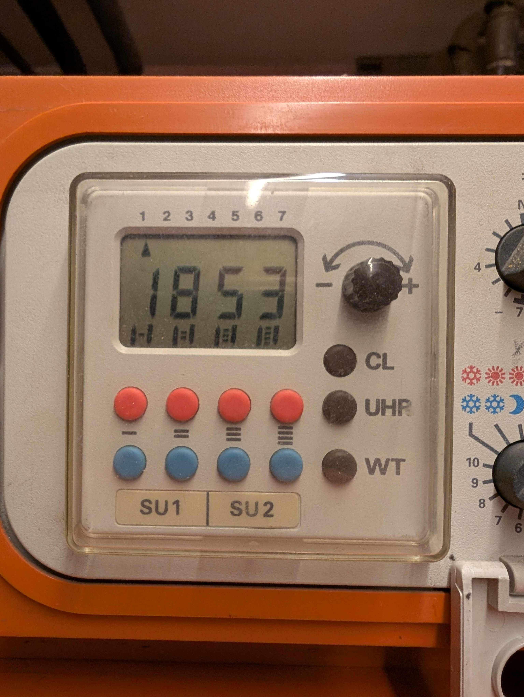
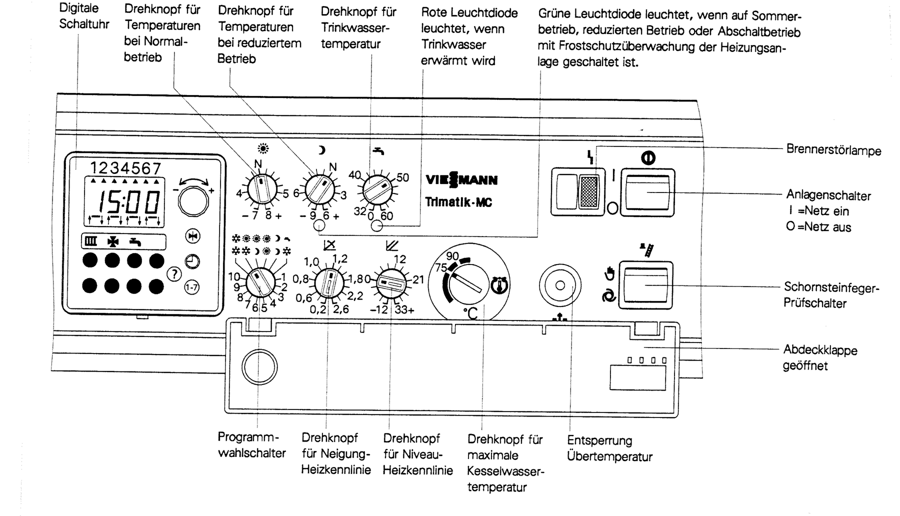
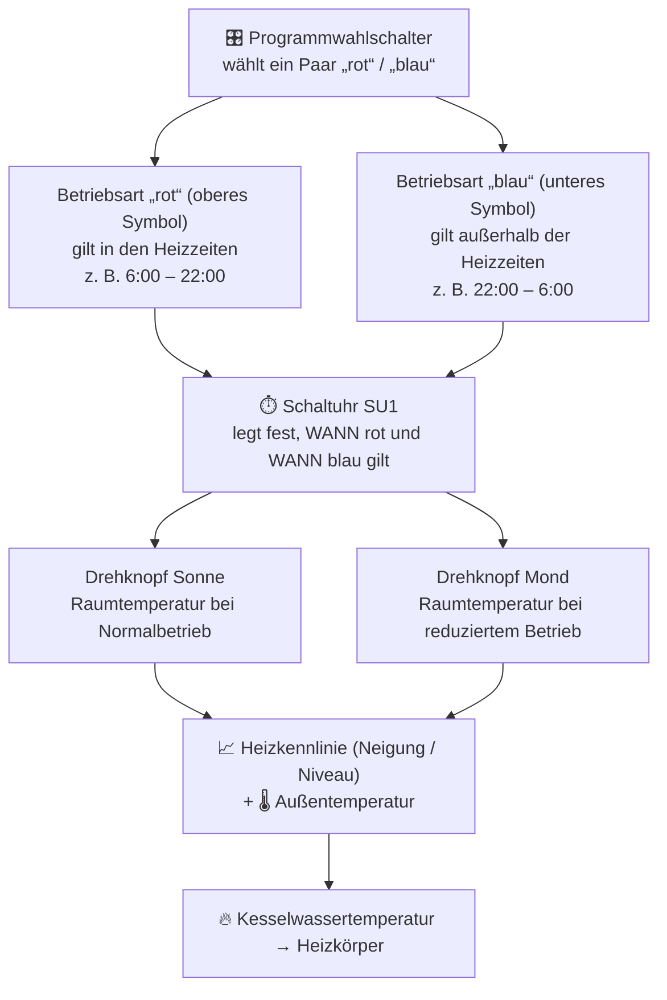
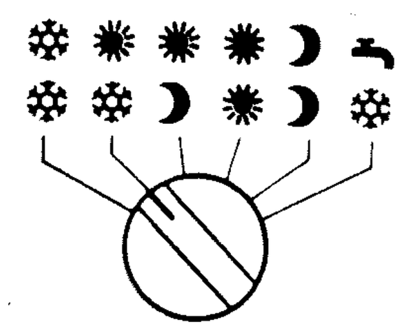

# Bedienung und Betriebsprogramme

## Bedienelemente

*Zeichnung des Bedienfelds aus der Original-Anleitung (Trimatik-MC). Das eingebaute Gerät ist gleich aufgebaut, nur die Schaltuhr-Tasten sind anders beschriftet.*

### Symbole auf einen Blick

Links das Symbol aus der Original-Anleitung, daneben das Textzeichen, das in dieser Anleitung dafür steht.
Wo es kein passendes Zeichen gibt, wird der Bildausschnitt verwendet.

| Original | Zeichen | Bedeutung | Wo |
|----------|---------|-----------|----|
|  | ☀︎ | **Normalbetrieb** (Tag) | Drehknopf Raumtemperatur Tag, Programmwahlschalter |
|  | ☽ | **Reduzierter Betrieb** (Nacht, Absenkung) | Drehknopf Raumtemperatur Nacht, Programmwahlschalter, grüne LED |
|  | ❄︎ | **Abschaltbetrieb mit Frostschutz** (Heizung aus) | Programmwahlschalter |
|  |  *(kein Zeichen, Bild)* | **Trinkwassererwärmung** (Warmwasser) | Drehknopf Warmwasser, Programmwahlschalter, rote LED, Kanal `SU2` |
|  | ▥ | Schaltuhr-Kanal **Heizkreis** | an deinem Gerät `SU1` |
|  | ✠ | Schaltuhr-Kanal Heizkreis mit Mischer | nur Trimatik-MC, hier nicht vorhanden |
|  | − / + | Einstell-Drehknopf der Schaltuhr | Werte ändern |
|  | ⏲︎ *(ähnlich)* | Uhrzeit anzeigen / stellen | an deinem Gerät Taste `UHR` |
|  | 1-7 | Wochentag anzeigen / stellen | an deinem Gerät Taste `WT` |
|  |  *(kein Zeichen, Bild)* | Grundeinstellung – **löscht alle Schaltzeiten** | an deinem Gerät Taste `CL` (versenkt) |
|  | ? | Abfrage der Ist-Temperaturen | nur Trimatik-MC, hier nicht vorhanden |
|  | ⊏ | Programmwahlschalter (Betriebsprogramm) | unten links neben der Schaltuhr |
|  | ∡ *(ähnlich)* | Neigung der Heizkennlinie | hinter der Abdeckklappe |
|  | ⫽ *(ähnlich)* | Niveau der Heizkennlinie | hinter der Abdeckklappe |
|  |  *(kein Zeichen, Bild)* | Temperaturregler, max. Kesselwassertemperatur | hinter der Abdeckklappe, nicht verstellen |
|  |  *(kein Zeichen, Bild)* | Entsperrung Übertemperatur | hinter der Abdeckklappe, nur Fachbetrieb |
|  |  *(kein Zeichen, Bild)* | Schornsteinfeger-Prüfschalter | rechts, nach der Messung zurückstellen |
|  | ⏻ | Anlagenschalter `I` ein / `O` aus | rechts oben |

### Schaltuhr (linker Block)

| Am Gerät                       | In der Anleitung (Trimatik-MC) | Funktion                                                                 |
|--------------------------------|--------------------------------|--------------------------------------------------------------------------|
| Anzeige `1 2 3 4 5 6 7` mit ▲   | 1–7                            | Wochentag, ▲ zeigt den aktuellen Tag (1 = Montag … 7 = Sonntag)          |
| Zifferanzeige `18:53`           | –                              | Uhrzeit, beim Programmieren die Schaltzeit, sonst auch Kesseltemperatur  |
| Symbole unten `−  =  ≡  ≣`      | Schaltzeitraum 1 bis 4         | zeigen, welche Schaltzeiträume belegt sind (↑ Beginn, ↓ Ende)             |
| Drehknopf `− ↶↷ +`              | Einstell-Drehknopf             | Werte verändern (Uhrzeit, Schaltzeiten, Wochentag)                        |
| **rote Tasten** (4 Stück)       | rote Taste                     | **Beginn** der Heizzeit („rot“) = Ende der Absenkung („blau“)             |
| **blaue Tasten** (4 Stück)      | blaue Taste                    | **Ende** der Heizzeit („rot“) = Beginn der Absenkung („blau“)             |
| `SU1`                           | Kanal ▥ (Heizkreis)            | Schaltuhr-Kanal 1 = **Heizkreis** *(vermutlich die linken 2 Tastenspalten)* |
| `SU2`                           | Kanal  (Trinkwasser)          | Schaltuhr-Kanal 2 = **Warmwasser** *(vermutlich die rechten 2 Tastenspalten)* |
| `UHR`                           | ⏲︎                              | Uhrzeit anzeigen / stellen                                                |
| `WT`                            | 1-7                            | Wochentag anzeigen / stellen, einzelnen Tag programmieren                 |
| `CL`                            |  Grundeinstellungstaste       | **Alles löschen** – setzt alle Schaltzeiten auf Werk (6–22 Uhr) zurück    |

!!! warning "Vermutung – bitte am Gerät prüfen"

    Die Beschriftung `SU1 | SU2` sitzt mittig unter den vier Tastenspalten.
    Ich lese das so: Spalte 1 + 2 (Symbole `−` und `=`) = zwei Zeiträume für den
    **Heizkreis**, Spalte 3 + 4 (Symbole `≡` und `≣`) = zwei Zeiträume fürs **Warmwasser**.
    Das passt zu „ein oder zwei Zeiträume“. **Prüfen:** Rote Taste der Spalte 1 kurz
    drücken. Erscheint die Einschaltzeit der Heizung (ab Werk `6:00`), stimmt die Zuordnung.

### Drehknöpfe und Schalter (rechter Block)

| Symbol | Name                              | Funktion                                                        | Werk       |
|--------|-----------------------------------|-----------------------------------------------------------------|------------|
| ☀︎      | Normalbetrieb (Tag)               | gewünschte Raumtemperatur tagsüber, 1 Teilstrich ≈ 1 °C          | `N` ≈ 20 °C |
| ☽      | Reduzierter Betrieb (Nacht)       | gewünschte Raumtemperatur bei Absenkung, 1 Teilstrich ≈ 1 °C     | `N` ≈ 14 °C |
|      | Trinkwasser                       | Warmwassertemperatur 32 – 60 °C, `0` = Warmwasser aus            | 50 °C      |
| ⊏ | **Programmwahlschalter**        | Betriebsprogramm, siehe [Betriebsprogramm wählen (Programmwahlschalter)](bedienung.md#betriebsprogramm-wahlen-programmwahlschalter)                              | ☀︎/❄︎        |
| ∡ (hinter der Klappe) | Neigung Heizkennlinie | 0,2 – 2,6, siehe [Heizkurve einstellen](heizkurve.md)                                     | 1,2        |
| ⫽ (hinter der Klappe) | Niveau Heizkennlinie  | −12 … +33, siehe [Heizkurve einstellen](heizkurve.md)                                     | 0          |
|  (hinter der Klappe) | Temperaturregler      | maximale Kesselwassertemperatur – **nicht verstellen**           | 75 °C      |
|  | Schornsteinfeger-Prüfschalter | nur für die Abgasmessung, danach zurückstellen                   | –          |
| ⏻ | Anlagenschalter `I` / `O` | Regelung ein / aus                                               | `I`        |

**Leuchtdioden:** rote LED am -Knopf leuchtet, wenn der Speicher aufgeheizt wird.
Grüne LED am ☽-Knopf leuchtet bei reduziertem Betrieb, Abschaltbetrieb oder
Nur-Warmwasser. Blinken beide zugleich: Programmwahlschalter steht zwischen zwei Rasten.

## Wie alles zusammenhängt

Die Regelung kennt vier **Betriebsarten**. Welche gerade aktiv ist, bestimmen zwei Dinge
zusammen: das **Betriebsprogramm** (Programmwahlschalter) und die **Schaltuhr**.

### Die vier Betriebsarten

| Symbol | Betriebsart                                  | Was passiert                                                                                                  |
|--------|----------------------------------------------|---------------------------------------------------------------------------------------------------------------|
| ☀︎      | **Normalbetrieb**                            | Heizen auf die Temperatur am ☀︎-Knopf. Warmwasser nach Zeitprogramm `SU2`.                                     |
| ☽      | **Reduzierter Betrieb**                      | Heizen auf die niedrigere Temperatur am ☽-Knopf (Nachtabsenkung). Kein Warmwasser.                            |
| ❄︎      | **Abschaltbetrieb mit Frostschutz**          | Kessel aus. Unter +1 °C außen heizt er im reduzierten Betrieb, über +3 °C wieder aus. Pumpe läuft alle 24 h kurz. Kein Warmwasser. |
|      | **Nur Trinkwassererwärmung**                 | Kessel heizt nur für den Warmwasserspeicher (nach Zeitprogramm `SU2`), Heizkörper bleiben kalt (Frostschutz aktiv). |

**Automatik, die man kennen sollte:**

- **Sommerabschaltung:** Steigt die Außentemperatur um 1 °C über die eingestellte
  Raumtemperatur, schaltet die Heizkreispumpe ab. Sinkt sie wieder 1 °C darunter, geht
  sie an. Im Frühjahr/Herbst schaltet die Heizung dadurch selbstständig zwischendurch ab.
- **Trägheit:** Heizbeginn 6:00 heißt nicht, dass es um 6:00 warm ist. Zeiten so legen,
  dass die Anlage Zeit zum Aufheizen und Abkühlen hat (je nach Haus 1 – 2 Stunden).
- **Untere Kesseltemperatur:** Der Kessel hält im Normalbetrieb eine Mindesttemperatur
  (Korrosionsschutz). Das ist gewollt und nicht einstellbar.

## Betriebsprogramm wählen (Programmwahlschalter)

Der Programmwahlschalter hat sechs Rasten. Jede Raste ist ein **Paar**: oberes Symbol =
Betriebsart „rot“ (in den Heizzeiten), unteres Symbol = Betriebsart „blau“ (außerhalb).

*Die sechs Stellungen, Zeichnung aus der Original-Anleitung. Am Gerät ist die obere Reihe rot, die untere blau gedruckt.*

| Stellung (oben/unten) | Bedeutung                                                        | Wann sinnvoll                                                               | Warmwasser |
|-----------------------|------------------------------------------------------------------|-----------------------------------------------------------------------------|------------|
| **❄︎ / ❄︎**             | Dauernd aus, nur Frostschutz. Schaltuhr ohne Wirkung.            | Urlaub im Winter                                                            | nein       |
| **☀︎ / ❄︎**             | Tags Normalbetrieb, nachts **ganz aus** mit Frostschutz. *(Werk)* | Massive Häuser, die nachts kaum auskühlen                                   | ja, nach `SU2` |
| **☀︎ / ☽**             | Tags Normalbetrieb, nachts **abgesenkt**.                         | **Normalfall** – wenn die Räume bei ☀︎/❄︎ morgens zu kalt sind                | ja, nach `SU2` |
| **☀︎ / ☀︎**             | Dauernd Normalbetrieb. Schaltuhr ohne Wirkung.                   | Feiertag, Besuch, Krankheit – danach zurückstellen                          | ja, nach `SU2` |
| **☽ / ☽**             | Dauernd reduziert. Schaltuhr ohne Wirkung.                       | Längere Abwesenheit im Winter, wenn Haus nicht auskühlen soll               | nein       |
| ** / ❄︎**            | Nur Warmwasser, Heizung aus mit Frostschutz.                     | **Sommer**                                                                  | ja, nach `SU2` |

Einstellen: Schalter einfach auf die gewünschte Raste drehen, wirkt sofort.
