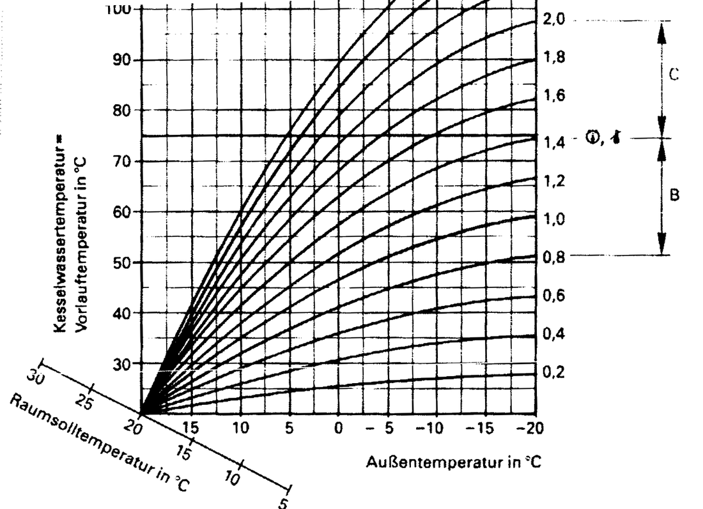
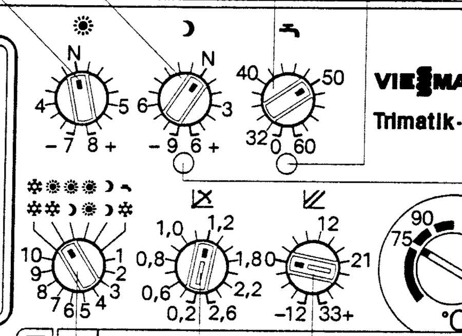

# Heizkurve einstellen

Diese Seite erklärt, wie du die Heizkurve deiner **Viessmann Trimatik** am
**Vitola-biferral-RN** selbst einstellst. Oben steht ein Rechner, der genau so rechnet
wie dein Regler. Darunter folgt die Anleitung Schritt für Schritt.

!!! info "Kurz gesagt"

    Ja: Die Heizkurve legt fest, **mit welcher Vorlauftemperatur der Kessel bei welcher
    Außentemperatur heizt**. Der Fühler an der Hauswand misst die Außentemperatur, die
    Trimatik liest daraus den Sollwert ab, und der Brenner heizt den Kessel auf diesen Wert.
    Deine Anlage hat einen Heizkreis ohne Mischer. Darum ist bei dir
    **Vorlauftemperatur = Kesselwassertemperatur**.

    In der Original-Anleitung heißt die Heizkurve **Heizkennlinie**. Gemeint ist dasselbe.

!!! tip "Die richtige Reihenfolge"

    **1. [Entlüften](entlueften.md)** → **2. [Hydraulischer Abgleich](abgleich.md)** →
    **3. Heizkurve einstellen**. Jeder Schritt baut auf dem vorherigen auf.

---

## Heizkurven-Rechner

Stell die vier Knöpfe so ein wie an deinem Kessel und wähle die Außentemperatur. Der
Rechner zeigt dir, auf welche Temperatur der Kessel regelt, und markiert den Punkt auf
deiner Kurve.

<noscript>Der Rechner braucht JavaScript. Die Richtwerte stehen weiter unten in der Tabelle.</noscript>

??? note "Wie genau ist der Rechner?"

    - **Kurvenform:** Ich habe alle 13 Kennlinien aus Abb. 17 der Original-Anleitung
      digitalisiert. Sie folgen exakt einer Formel:
      Vorlauf = Raumsoll + Niveau + Neigung × (1,6905 × d − 0,018 × d²), mit
      d = Raumsoll − Außentemperatur. Die Abweichung zum Original liegt unter 1 K, auch bei
      den Kennlinien 2,2 bis 2,6, die nicht in die Berechnung eingeflossen sind.
    - **Knopfskalen:** stammen aus der Zeichnung des Bedienfelds. Jeder Knopf hat 16
      Rastpositionen im Abstand von 20°. Neigung ist nicht gleichmäßig beschriftet, das
      bildet der Rechner nach.
    - **Grenzen in der Praxis:** Der Kessel pendelt um den Sollwert (Schaltdifferenz 4 K).
      Während der Warmwasserbereitung wird er heißer. Der Außenfühler misst an der Hauswand,
      Sonne und Wind verschieben den Wert gegenüber der Wetter-App. Und einen Knopf liest
      man auf etwa einen halben Strich genau ab.
    - **Speicher und Datenschutz:** Deine Knopfstellungen merkt sich nur dein Browser.
      Der Standort wird nur abgefragt, wenn du auf „Aktuelles Wetter laden“ tippst, und
      dann nur an den Wetterdienst Open-Meteo geschickt.

---

## So funktioniert die Heizkurve

*Abb. 17 aus der Original-Anleitung, gerade gerückt. Waagerecht die Außentemperatur
(links warm, rechts kalt), senkrecht die Vorlauftemperatur. Die Zahlen rechts sind die
Neigung. Gilt für Niveau 0 und Sonnen-Knopf auf N.*

Je kälter es draußen ist, desto heißer muss das Heizungswasser sein, damit die Räume
gleich warm bleiben. Die Kurve beschreibt genau diesen Zusammenhang. Alle Kurven beginnen
unten links bei 20 °C außen und 20 °C Vorlauf: Ist es draußen so warm wie drinnen,
braucht es keine Heizung.

### Die vier Knöpfe

*Oben die Knöpfe für Raumtemperatur Tag ☀︎, Nacht ☽ und Warmwasser, unten
Programmwahlschalter, Neigung ∡ und Niveau ⫽. Die untere Reihe liegt hinter der
Abdeckklappe.*

| Knopf | Wo | Skala | Werk | Was er mit der Kurve macht |
|-------|----|-------|------|----------------------------|
| **Neigung** ∡ | hinter der Klappe | 0,2 … 2,6 | 1,2 | macht die Kurve **steiler** oder **flacher**. Wirkt umso stärker, je kälter es ist. |
| **Niveau** ⫽ | hinter der Klappe | −12 … +33, 1 Strich = 3 K | 0 | schiebt die ganze Kurve **gleichmäßig** nach oben oder unten |
| **Tag** ☀︎ | oben links | N = ca. 20 °C, −7 … +8, 1 Strich = 1 K | N | verschiebt den **Fußpunkt** der Tageskurve. Wirkt überall, am stärksten bei milden Temperaturen. |
| **Nacht** ☽ | oben Mitte | N = ca. 14 °C, −9 … +6, 1 Strich = 1 K | N | dasselbe für die Nachtkurve (reduzierter Betrieb) |

**Die Skala der Neigung ist ungleichmäßig.** Zwischen 0,6 und 1,2 ist jeder Strich 0,1,
darunter und darüber 0,2. Die Striche heißen der Reihe nach 0,2 · 0,4 · 0,6 · 0,7 · 0,8 ·
0,9 · 1,0 · 1,1 · 1,2 · 1,4 · 1,6 · 1,8 · 2,0 · 2,2 · 2,4 · 2,6. Beschriftet sind nur
einige davon.

**Die Zahlen am Sonnen- und Mond-Knopf sind Abstände von N**, keine Temperaturen. Steht
der Sonnen-Knopf auf der „4“ links, sind das 4 K weniger als N, also etwa 16 °C.

### Wie stark wirkt ein Strich?

Berechnet für deine Werkseinstellung (Neigung 1,2, Niveau 0, Sonne auf N):

| Ein Strich mehr an … | bei +10 °C außen | bei 0 °C | bei −10 °C |
|----------------------|------------------|----------|------------|
| ☀︎ Tag (Raumsoll +1 K) | +2,6 K Vorlauf | +2,2 K | +1,7 K |
| ⫽ Niveau | +3 K | +3 K | +3 K |
| ∡ Neigung 1,2 → 1,4 | +3,0 K | +5,3 K | +6,9 K |
| ∡ Neigung 1,0 → 1,1 | +1,5 K | +2,7 K | +3,5 K |

Daraus folgt die wichtigste Regel: **Neigung für kalte Tage, Niveau und Sonnen-Knopf für
milde Tage.** Wer bei Frost friert, aber im Herbst zufrieden ist, braucht mehr Neigung.
Wer im Herbst friert, aber bei Frost zufrieden ist, braucht mehr Niveau und dafür etwas
weniger Neigung.

---

## Richtwerte für deine Anlage

Vorlauftemperatur in °C mit Niveau 0 und Sonnen-Knopf auf N. Werte aus dem geprüften
Modell, gerundet.

| Neigung | +15 °C | +10 °C | +5 °C | 0 °C | −5 °C | −10 °C | −15 °C | −20 °C |
|---------|--------|--------|-------|------|-------|--------|--------|--------|
| 0,8 | 35* | 35* | 37 | 41 | 45 | 48 | 50 | 51 |
| 1,0 | 35* | 35 | 41 | 47 | 51 | 55 | 57 | 59 |
| 1,1 | 35* | 37 | 43 | 49 | 54 | 58 | 61 | 63 |
| **1,2 (Werk)** | 35* | 38 | 46 | 52 | 57 | 61 | 65 | 67 |
| 1,4 | 35* | 41 | 50 | 57 | 63 | 68 | 72 | 74 |
| 1,6 | 35* | 44 | 54 | 63 | 70 | 75 | 75* | 75* |

\* Kessel an seiner Grenze: unten hält er etwa 35 °C, oben begrenzt er auf 75 °C.

**Wo deine Heizung vermutlich liegt:**

| Haus und Heizkörper | übliche Neigung |
|---------------------|-----------------|
| Altbau, wenig gedämmt, kleine Heizkörper | 1,4 – 1,6 |
| Altbau, Heizkörper, freie Lage (typisch bei Kesseln dieser Zeit) | 1,2 |
| gut gedämmt, geschützte Lage, Heizkörper | 1,0 |
| später gedämmt, neue Fenster, große Heizkörper | 0,8 – 1,0 |
| Fußbodenheizung (bei dir nicht vorhanden) | 0,2 – 0,8 |

Ein guter Prüfpunkt ist die **Norm-Außentemperatur** deiner Region, in Deutschland meist
zwischen −10 und −16 °C. Bei dieser Temperatur sollte die Kurve gerade so viel liefern,
dass alle Räume warm werden. Ältere Heizkörper-Anlagen wurden oft für 70 °C Vorlauf und mehr
bei Normtemperatur ausgelegt. Seitdem gedämmt oder Fenster getauscht? Dann reicht meist deutlich
weniger.

---

## Bevor du loslegst

1. **Ausgangslage festhalten.** Fotografiere die Knöpfe, auch die hinter der Klappe, und
   trag die Werte auf der Seite [Notizen](notizen.md) ein. So kommst du jederzeit zurück.
2. **[Heizkörper entlüften](entlueften.md) und Anlagendruck prüfen.** Luft im Heizkörper
   sieht aus wie eine zu niedrige Heizkurve.
3. **Werden alle Heizkörper gleichmäßig warm?** Wenn einzelne Räume immer kalt bleiben,
   während andere überheizen, fehlt der [hydraulische Abgleich](abgleich.md). Das löst keine
   Heizkurve.
4. **Referenzraum wählen.** Am besten der Raum, in dem du es am wärmsten haben willst,
   oder der Raum, der am schwersten warm wird. Meist ist das das Wohnzimmer.
5. **Thermometer aufstellen.** Im Referenzraum auf etwa 1 m Höhe, an einer Innenwand,
   nicht in der Sonne und nicht über dem Heizkörper.
6. **Thermostatventile:** Im Referenzraum während der Einstellphase **ganz auf** (Stufe 5).
   In den übrigen Räumen so wie immer, Stufe 3 entspricht etwa 20 °C.
7. **Kein Kaminofen, keine offenen Fenster, keine Party** im Referenzraum, während du
   bewertest. Fremdwärme verfälscht das Ergebnis.
8. **Programmwahlschalter auf ☀︎/☽** und Schaltuhr wie gewohnt. Bewerte nur in der
   Tag-Phase und erst, wenn die Heizung schon drei bis vier Stunden läuft, also
   zum Beispiel am späten Nachmittag.
9. **Außentemperatur notieren.** Wetter-App oder der Knopf „Aktuelles Wetter laden“ im
   Rechner. Ein Thermometer an der Nordseite des Hauses ist noch besser.
10. **Kesseltemperatur ablesen**, wenn es geht. Je nach Ausstattung in der Anzeige (Wert mit
    °C) oder an einem Thermometer am Kessel. Ein günstiges Anlegethermometer am Vorlaufrohr
    direkt am Kessel geht immer. Den Wert kannst du im Rechner als Ist-Wert eintragen.

---

## Schritt für Schritt

Die Grundregeln für alle Schritte:

- **Immer nur einen Knopf ändern**, und das um **einen Strich**.
- **Dann 24 bis 48 Stunden warten.** Ein Haus reagiert langsam. Wer nach zwei Stunden
  nachdreht, jagt der eigenen Änderung hinterher.
- **Bei ähnlichem Wetter vergleichen.** Ein Ergebnis bei 10 °C sagt nichts über −5 °C.
- **Alles ins [Protokoll](#protokoll) schreiben.** Nach zwei, drei Wochen siehst du ein
  klares Muster.

### Schritt 1 · Beobachten (1 bis 2 Tage)

Ändere noch nichts. Notiere zweimal am Tag Außentemperatur, Raumtemperatur im Referenzraum
und wenn möglich die Kesseltemperatur. Prüfe im Rechner, ob der Kessel ungefähr den Wert
fährt, den deine Knopfstellung erwarten lässt. Abweichungen bis etwa 3 K sind normal.

### Schritt 2 · Milde Tage (+5 bis +15 °C): das Grundniveau

Jetzt im Herbst und im Frühjahr ist die richtige Zeit für diesen Schritt.

- **Referenzraum zu kühl:** Sonnen-Knopf ☀︎ einen Strich Richtung **+**.
- **Referenzraum zu warm:** Sonnen-Knopf ☀︎ einen Strich Richtung **−**.
- Ziel: Mit Thermostat auf 5 wird der Referenzraum gerade so warm, wie du es willst, und
  nicht wärmer.

Den Sonnen-Knopf nimmst du hier, weil er genau für die Wohlfühltemperatur gedacht ist.
Er verschiebt außerdem die Sommerabschaltung passend mit: Die Heizkreispumpe geht aus,
sobald es draußen 1 K wärmer ist als die eingestellte Raumtemperatur.

### Schritt 3 · Kalte Tage (unter 0 °C): die Neigung

Diesen Schritt machst du erst, wenn es richtig kalt ist.

- **Bei Frost zu kühl, an milden Tagen passt es:** Neigung einen Strich **höher**.
- **Bei Frost zu warm, an milden Tagen passt es:** Neigung einen Strich **niedriger**.

### Schritt 4 · Die Feinkorrektur, wenn beides nicht passt

| Was du beobachtest | Was du änderst |
|--------------------|----------------|
| Bei **Frost** zu kalt, an **milden** Tagen in Ordnung | **Neigung** einen Strich höher |
| Bei **Frost** zu warm, an **milden** Tagen in Ordnung | **Neigung** einen Strich niedriger |
| An **milden** Tagen zu kalt, bei **Frost** in Ordnung | erst **Niveau** einen Strich höher, nach ein paar Tagen **Neigung** einen Strich niedriger |
| An **milden** Tagen zu warm, bei **Frost** in Ordnung | erst **Niveau** einen Strich niedriger, nach ein paar Tagen **Neigung** einen Strich höher |
| **Immer** zu kalt oder zu warm, egal bei welchem Wetter | **Sonnen-Knopf** ☀︎ einen Strich, nicht die Kurve |

Die Tabelle folgt der Korrekturtabelle der Original-Anleitung (Seite 39). Mit „Niveau höher,
Neigung niedriger“ wird die Kurve flacher, ohne dass sie an kalten Tagen absackt.

### Schritt 5 · Die Nachtabsenkung ☽

Erst wenn der Tag passt, kommt die Nacht.

- **Morgens dauert es zu lange, bis es warm ist:** Mond-Knopf ☽ einen Strich höher, oder in
  der Schaltuhr den Heizbeginn eine halbe Stunde früher legen.
- **Nachts wird es kaum kühler:** Das liegt meist an der Speichermasse des Hauses, nicht an
  der Regelung. Mond-Knopf niedriger oder das Heizende früher legen.
- Bei sehr massiven Häusern kann das Programm ☀︎/❄︎ (nachts ganz aus) sparsamer sein.
  Werden die Räume damit morgens zu kalt, bleib bei ☀︎/☽.

### Schritt 6 · So niedrig wie möglich

Wenn alles passt, drehe die Kurve probeweise noch einen Strich tiefer. Die beste Kurve ist
die **niedrigste, bei der alle Räume noch warm werden**. Ein einfacher Test an einem kalten
Tag:

- **Thermostate fast überall weit offen und alle Räume warm:** Die Kurve ist gut.
- **Thermostate überall stark gedrosselt, Heizkörper nur oben warm:** Die Kurve ist höher
  als nötig. Einen Strich tiefer probieren.
- **Ein Raum wird selbst auf Stufe 5 nicht warm, die anderen schon:** Das ist ein Fall für
  den [hydraulischen Abgleich](abgleich.md) oder einen zu kleinen Heizkörper, nicht für die Kurve.

Danach stellst du das Thermostat im Referenzraum wieder auf die gewohnte Stufe.

---

## Typische Fehler

- **Mehrere Knöpfe gleichzeitig verstellen.** Dann weiß niemand mehr, was gewirkt hat.
- **Zu früh bewerten.** Unter 24 Stunden ist das Ergebnis Zufall.
- **Einen kalten Raum mit der Kurve retten.** Dann überheizen alle anderen Räume, und ihre
  Thermostate müssen dagegen ankämpfen. Erst entlüften und [abgleichen](abgleich.md).
- **Kurve hoch, Thermostate runter.** Die Thermostate regeln dann dauernd ab, der Kessel
  läuft heißer als nötig, die Verluste steigen.
- **Den Temperaturregler (75 °C) oder die Entsperrung hinter der Klappe verstellen.** Das
  sind Sicherheits- und Grenzeinstellungen, keine Komfortknöpfe.
- **Außenfühler in der Sonne.** Bekommt der Fühler an der Hauswand Morgensonne, glaubt die
  Regelung, es sei warm, und drosselt. Dann hilft keine Kurve, sondern ein Schattenblech
  oder ein anderer Platz für den Fühler (Fachbetrieb).

---

## Protokoll

Druck die Seite aus oder trag die Werte auf der Seite [Notizen](notizen.md) ein.

| Datum | Uhrzeit | Außen °C | Raum °C | Kessel °C | Neigung | Niveau | ☀︎ | ☽ | Bemerkung |
|-------|---------|----------|---------|-----------|---------|--------|----|---|-----------|
| | | | | | | | | | |
| | | | | | | | | | |
| | | | | | | | | | |
| | | | | | | | | | |
| | | | | | | | | | |
| | | | | | | | | | |

---

## Grenzen deiner Regelung

Diese Punkte bildet der Rechner ab. Sie erklären, warum der Kessel nicht immer exakt die
Kurve fährt.

- **Obergrenze 75 °C.** Elektronische Begrenzung und Temperaturregler hinter der Klappe sind
  ab Werk auf 75 °C eingestellt. Steilere Kurven werden dort abgeschnitten.
- **Untergrenze etwa 35 °C.** Der Kessel hält im Heizbetrieb eine Mindesttemperatur zum
  eigenen Schutz. Laut Anleitung ist sie nicht einstellbar. Der genaue Wert hängt vom
  Kesseltyp ab.
- **Sommerabschaltung.** Ist es draußen 1 K wärmer als die eingestellte Raumtemperatur,
  schaltet die Heizkreispumpe ab. Unter 1 K kälter geht sie wieder an.
- **Frostschutz im Abschaltbetrieb ❄︎.** Unter +1 °C außen heizt der Kessel nach der
  Nachtkurve, über +3 °C ist er wieder aus.
- **Warmwasser hat Vorrang.** Während der Speicher lädt, wird der Kessel heißer als die
  Kurve, und die Heizkörper bekommen kurz keine Wärme.
- **Schaltdifferenz 4 K.** Der Brenner taktet. Die Kesseltemperatur schwankt deshalb um
  einige Grad um den Sollwert.
